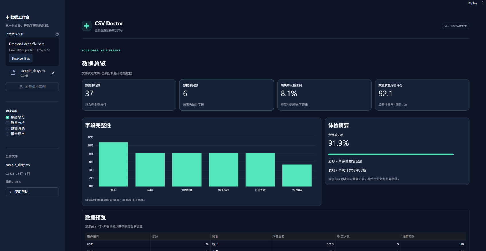
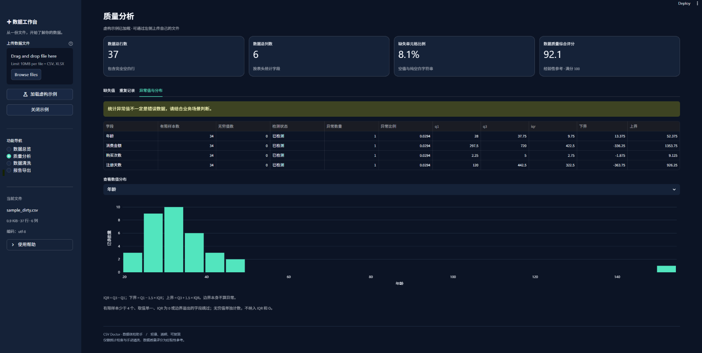
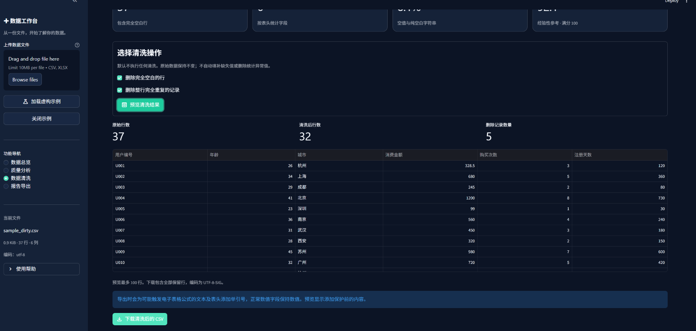
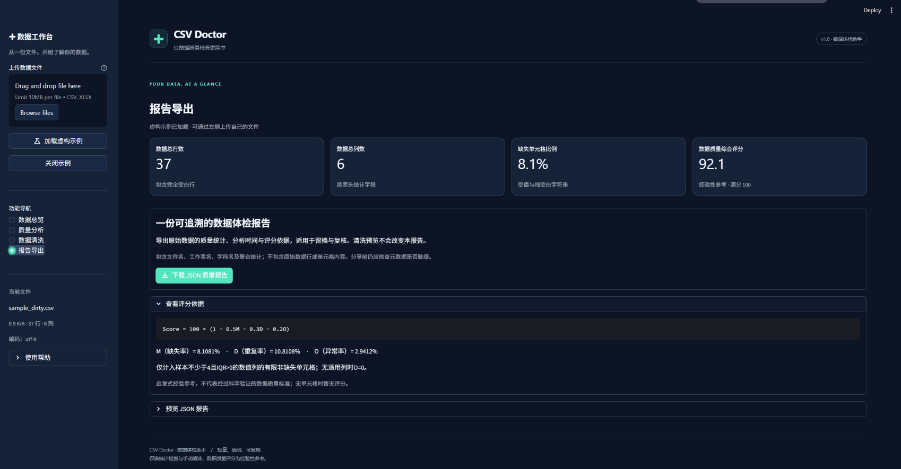
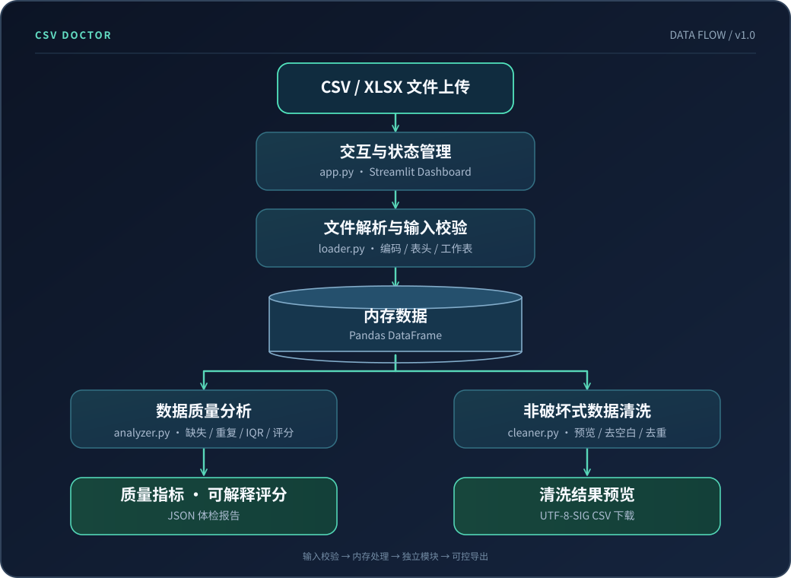

<div align="center">

<h1>🩺 CSV Doctor</h1>
<h3>让数据问题可见，让清洗过程可控。</h3>
<p><strong>A lightweight, transparent and reproducible CSV / Excel data quality toolkit.</strong></p>
<p>上传一份表格，即可完成质量体检、异常定位、可视化分析与可控清洗。<br>
基于 Python 的轻量级开源工具，无需账号、数据库或模型 API。</p>

<p>


</p>

</div>

---

**[功能与演示](#-功能一览)** · **[工程设计](docs/ENGINEERING.md)** · **[参与贡献](CONTRIBUTING.md)** · **[更新记录](CHANGELOG.md)** · **[快速开始](#-快速开始)**

## ✨ 项目概览

现实中的 CSV / Excel 数据往往存在**缺失值、完整重复记录、统计异常和字段类型不一致**等问题。人工逐列排查繁琐，直接清洗又容易破坏原始数据。

CSV Doctor 将这一流程整理为四个可解释的步骤：

**上传文件 → 数据体检 → 检查质量问题 → 预览并导出**。

- **快速发现问题**：行列概览、字段类型、缺失率、重复率和 IQR 异常检测。
- **可解释的质量评分**：展示完整的指标定义、权重及计算公式，而非黑盒打分。
- **非破坏式清洗**：默认不修改原始数据，操作由用户选择，预览后才导出。
- **面向真实文件的边界处理**：兼容常见中文 CSV 编码、Excel 多工作表，并限制输入规模。
- **工程可维护**：界面与核心逻辑分离，配套 pytest、GitHub Actions 和 MIT License。

### 真实运行截图

> 下图取自本项目在 Windows 本地运行的实际界面，展示的是**人工生成的虚构测试数据**。

<p align="center">
  
</p>

| 质量分析：IQR 异常检测 | 清洗预览：37 → 32 行 |
| :---: | :---: |
|  |  |

<details>
<summary><b>展开查看：JSON 质量报告导出界面</b></summary>

<br />



</details>

---

## 🚀 功能一览

| 功能模块 | 具体能力 | 设计说明 |
| --- | --- | --- |
| **文件解析** | CSV / XLSX；UTF-8、UTF-8-SIG、GB18030；Excel 工作表切换 | 上传文件在服务端内存处理，不主动持久化 |
| **数据总览** | 行列数、数据类型、记录预览、描述性统计 | 分析基于全部数据，预览只显示部分行 |
| **缺失检测** | 逐字段缺失数量和比例、整体缺失率 | 统一处理空值、空字符串、纯空白字符串 |
| **重复检测** | 整行字段比较、重复记录数量与比例 | 保留第一次出现的记录 |
| **异常检测** | 1.5 × IQR、上下界、各字段异常数量与分布 | 不满足统计条件时跳过并说明原因 |
| **质量评分** | 缺失、重复、异常三个维度的加权评分 | 公式与口径公开，属于启发式指标 |
| **数据清洗** | 删除完全空白行、完整重复行 | 手动选择、预览、下载，不修改原始表 |
| **报告导出** | UTF-8-SIG CSV、JSON 质量报告 | JSON 仅含文件元数据和汇总统计，不包含原始数据行 |

### 核心技术栈

| 层次 | 技术 | 承担的职责 |
| --- | --- | --- |
| 交互与展示 | **Streamlit 1.55.0** | 文件上传、工作表切换、会话状态、深色 Dashboard |
| 数据处理 | **Pandas 2.3.3** | 文件解析、类型推断、缺失与重复统计、DataFrame 操作 |
| 可视化 | **Plotly 6.7.0** | 缺失率柱状图、数值分布等交互图表 |
| Excel 解析 | **OpenPyXL 3.1.5** | XLSX 工作簿和工作表读取 |
| 自动化测试 | **pytest 8.4.2** | 算法边界、上传逻辑、状态一致性及导出验证 |
| 持续集成 | **GitHub Actions** | 在 Python 3.11 / 3.12 上运行测试工作流 |

## 🏗️ 系统架构

项目采用**轻量分层设计**，不引入数据库或不必要的前后端分离。界面层只负责用户交互和结果展示，统计与清洗逻辑放在独立模块，便于测试和维护。



```text
csv-doctor/
├── app.py                     # Streamlit 界面与交互状态
├── src/
│   ├── loader.py              # 文件读取、输入校验与编码处理
│   ├── analyzer.py            # 数据质量分析、评分与报告
│   └── cleaner.py             # 非破坏式清洗与 CSV 导出
├── tests/                     # 核心逻辑与应用交互测试
├── data/sample_dirty.csv      # 人工构造的虚构测试数据
├── docs/images/               # 实际运行截图
├── .streamlit/config.toml     # Streamlit 主题与运行配置
├── .github/workflows/tests.yml # GitHub Actions 自动测试
├── requirements.txt
├── pytest.ini
├── .gitignore
├── LICENSE
└── README.md
```

## 🧠 技术难点与解决方案

以下内容描述的是**当前版本已实现的工程处理**，不是未实际验证的性能优化或科研创新。

### 01 · 不同来源表格的解析一致性

**问题：** CSV 文件可能采用不同编码；空字符串、空白行与 `NA` 等字面文本容易被解析器混淆；Excel 还涉及多工作表和不规范表头。

**处理方式：**
- CSV 按 UTF-8 / UTF-8-SIG 优先、GB18030 回退；文件头必须非空且唯一。
- 保留完全空白的记录，统一识别空值与纯空白字符串，同时不将字面文本 `NA` / `NULL` 无条件视为缺失。
- 数字型业务编号中有前导零时保留文本语义；XLSX 支持选择工作表，不执行单元格公式。

**取舍：** 目前不自动识别分号分隔符，也不支持复杂的合并表头；这是有意限定的输入边界。

### 02 · 让统计异常检测可解释，而不是机械地标红

**问题：** IQR 对样本数量和数据分布敏感。如果数据太少、取值全部相同或 IQR = 0，强行判断可能误导用户。

**处理方式：** 使用 1.5 倍四分位距确定上下界；在有限有效样本不足 4、IQR = 0、取值单一等情况下**跳过并说明原因**；无穷值单独处理。用户可以查看每列的 Q1、Q3、IQR、阈值与异常数量。

**取舍：** IQR 判断的是统计上的离群点，**不等于业务错误**；数值型编码、偏态数据或小样本尤其需要人工判断。

### 03 · 处理重复问题与清洗操作的交叉影响

**问题：** 完全空白行也可能相互重复。如果直接把“空白行数量”和“重复行数量”相加，可能高估实际删除记录数。

**处理方式：** 清洗按**先删完全空白行、再删完整重复行**的顺序执行，统一空白字段并保留首次记录；原始数据不原地修改。文件、工作表或清洗选项变化后，原清洗预览失效，避免下载与当前选择不匹配的旧结果。

### 04 · 兼顾导出可用性和电子表格安全

**问题：** 直接导出含 `=`、`+`、`-`、`@` 等前缀的用户文本，可能被部分电子表格软件解释为公式；中文 CSV 在某些 Excel 环境下还可能出现乱码。

**处理方式：** 使用 UTF-8-SIG 输出 CSV，对具有公式触发风险的**文本和表头**采用前置单引号保护，正常数值字段保留数值形式。JSON 仅导出聚合分析结果，不包含原始行数据。

**取舍：** 文本保护会改变高风险字符串的字面内容，不同电子表格软件行为也可能不同，因此界面会提示用户。JSON 的文件名、字段名与聚合统计仍需关注隐私。

### 05 · 在免费部署环境中控制资源使用

**问题：** 即使上传文件本身不大，读取和解析后也可能产生较大的内存占用，XLSX 的解压体积还可能显著超过原始文件大小。

**处理方式：** 设置输入上限：单文件 **10 MiB**、最多 **100,000 行 / 200 列 / 2,000,000 单元格**，并对 XLSX 声明的解压大小设置 **64 MiB** 上限。上传内容在服务端内存中处理，不主动保存原文件或使用跨用户共享的数据缓存。

**取舍：** CSV Doctor 是轻量分析工具，不是面向超大规模数据或高并发场景的数据处理引擎。

---

想了解模块设计和工程边界，可阅读 [工程设计说明](docs/ENGINEERING.md)。

## 📊 可复现的示例与评分

仓库提供 `data/sample_dirty.csv`，数据**完全虚构**，包含缺失字段、整行重复、完全空白行和数值离群点。可直接在首页点击「加载虚构示例」。

| 体检指标 | 示例结果 |
| --- | ---: |
| 数据规模 | 37 行 × 6 列 |
| 缺失单元格 | 18 / 222 = **8.11%** |
| 完整重复记录 | 4 / 37 = **10.81%** |
| IQR 统计异常 | **4** 个单元格 |
| 质量评分 | **92.11 / 100** |
| 两种清洗操作同时执行 | **37 → 32** 行 |

质量评分公开采用：

```text
Score = 100 × (1 - 0.5M - 0.3D - 0.2O)

M = 缺失单元格数 / 全部单元格数
D = 完整重复行数 / 全部行数
O = 适用 IQR 的数值列中，异常单元格 / 有限且非缺失的数值单元格
```

结果限制为 0–100；无适用数值列时 `O = 0`；无行或无列时不输出分数。**该公式是透明的启发式参考，未经过业务场景验证，不应作为通用数据质量标准。**

## ⚡ 快速开始

> 适用 Python **3.11 / 3.12**。所有命令在克隆后的项目根目录运行；请使用虚拟环境，避免影响全局 Python。

**Windows · PowerShell**

```powershell
# 在项目根目录执行
python -m venv .venv
.\.venv\Scripts\python.exe -m pip install -r requirements.txt
.\.venv\Scripts\python.exe -m streamlit run app.py --server.address=127.0.0.1
```

**macOS / Linux**

```bash
python3 -m venv .venv
./.venv/bin/python -m pip install -r requirements.txt
./.venv/bin/python -m streamlit run app.py --server.address=127.0.0.1
```

打开浏览器访问 `http://127.0.0.1:8501`。如默认端口被占用，可启动时添加 `--server.port=8502`。项目不需要 API Key、数据库或额外的系统服务。

**使用流程：** 上传 CSV / XLSX 或加载虚构示例 → 查看「数据总览」 → 在「质量分析」定位问题 → 在「数据清洗」选择操作并预览 → 下载 CSV 或 JSON 报告。

## ✅ 测试与持续集成

```bash
python -m pytest -q
```

测试涵盖：文件格式与编码、空值和重复检测、IQR 边界、评分、原始 DataFrame 不可变性、CSV 公式保护、JSON 序列化，以及应用导航、工作表切换和清洗预览状态。

仓库附带 `.github/workflows/tests.yml`，配置在 push 和 pull request 时对 Python **3.11 / 3.12** 运行 pytest。**首次公开发布后，以 GitHub Actions 的实际结果为准**；本地通过不代表云端部署已验证。

## ☁️ 免费部署

可部署至 [Streamlit Community Cloud](https://share.streamlit.io/)：连接 GitHub → 选择仓库及 `main` 分支 → 入口文件填写 `app.py` → 选择 Python 3.12 → 发布。当前项目不需要 Secrets。

网站成功上线并验证后，可在此 README 顶部加入**真实在线演示链接**及 CI 状态徽章；上线前不放置虚构或失效链接。

> **隐私提示：** 云端版本需要将文件上传至运行服务的服务器，并非完全离线的浏览器工具。请不要上传包含敏感个人信息、商业机密或凭据的数据文件。

## 🔒 已知边界与后续方向

- 仅支持 `.csv` / `.xlsx`；不支持 `.xls`、加密 Excel、复杂合并表头、多行表头与自动分隔符猜测。
- 不保证所有业务数据的类型推断完全准确；纯数字标识符及日期等可能需要人工确认。
- 不自动填补缺失值或删除统计异常，不提供自定义字段规则、XLSX 导出或超大文件分块处理。
- CSV 清洗导出不保留原 Excel 的样式、公式计算结果或多工作表结构。
- 尚未把本项目作为企业级高并发、安全审计或生产负载系统验证。

后续可考虑：**字段级校验规则、可选分隔符 / 编码配置、更细化的异常检测策略、交互式列类型修正及可访问性优化**。这些均属于未来计划，不是 v1.0 已实现功能。

## 📄 License

本项目采用 [MIT License](LICENSE)。欢迎通过 Issue / Pull Request 提出改进建议；提交复现数据时请使用虚构或脱敏数据。
