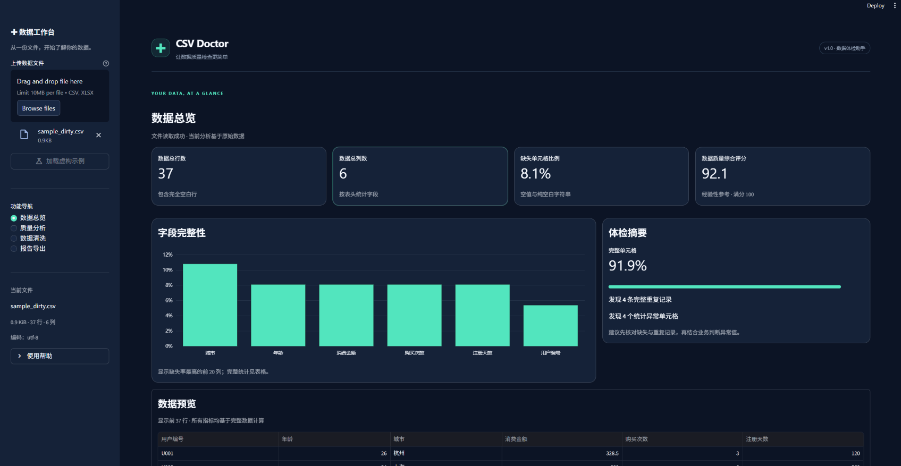
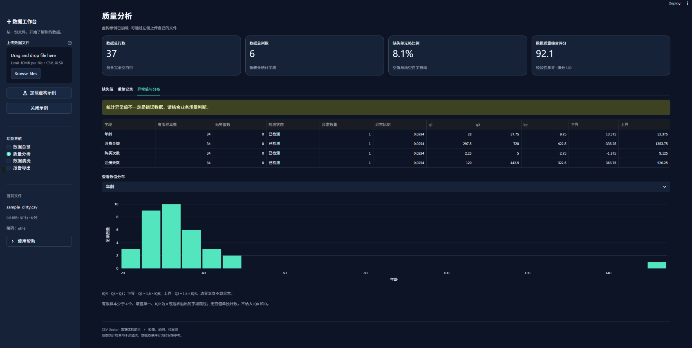
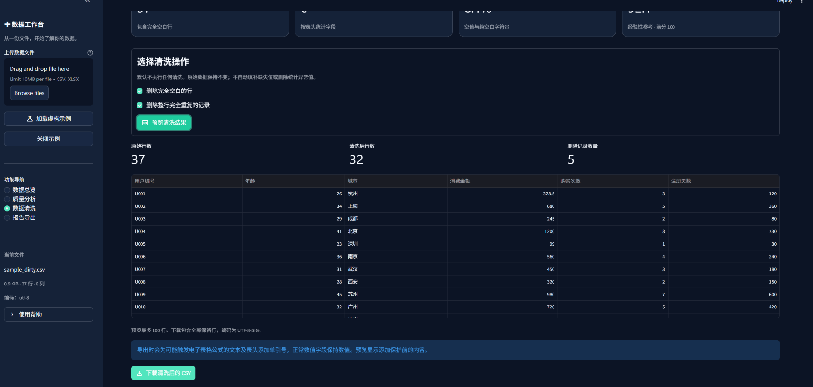
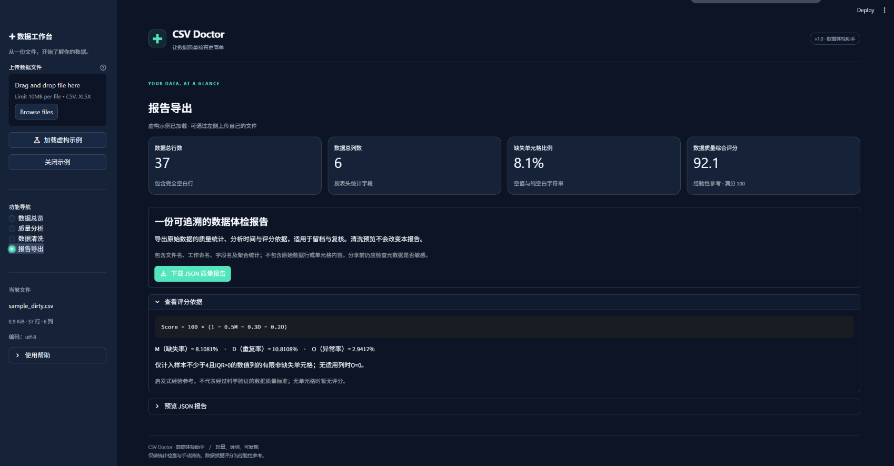
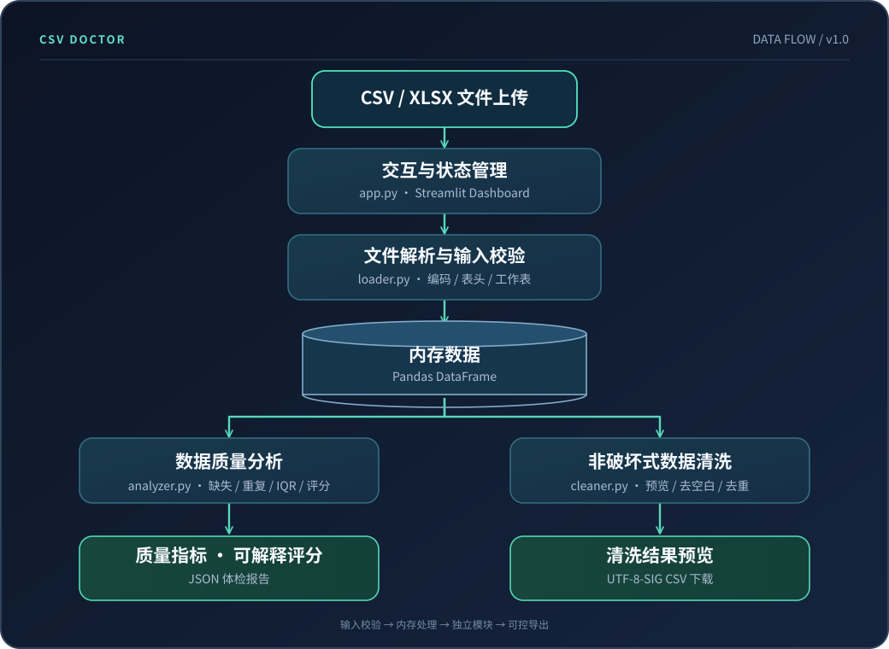

<div align="center">

<h1>🩺 CSV Doctor</h1>
<h3>Make data problems visible, and keep cleaning under control.</h3>
<p><strong>A lightweight, transparent and reproducible CSV / Excel data quality toolkit.</strong></p>
<p>Upload a spreadsheet to run a quality checkup, locate anomalies, explore visualizations and perform controlled cleaning.<br>
A lightweight, open-source Python tool — no account, database or model API required.</p>

<p>


</p>

<p><a href="README.md">English</a> | <a href="README.zh-CN.md">简体中文</a></p>

<p><strong><a href="docs/images/demo.gif">▶ Watch the demo GIF</a></strong></p>


</div>

<p align="center">
  
</p>

<p align="center"><sub>Animated demo: load the synthetic sample → inspect data quality → preview cleaning → export a report.</sub></p>

---

**[Features & Demo](#-features)** · **[Engineering](docs/ENGINEERING.md)** · **[Contributing](CONTRIBUTING.md)** · **[Changelog](CHANGELOG.md)** · **[Quick Start](#-quick-start)**

## ✨ Project Overview

Real-world CSV / Excel data often suffers from **missing values, exact duplicate records, statistical outliers and inconsistent field types**. Checking every column by hand is tedious, and cleaning the data directly can easily damage the original table.

CSV Doctor distills this workflow into four explainable steps:

**Upload file → Quality checkup → Review quality issues → Preview and export.**

- **Find problems quickly**: row and column overview, field types, missing rate, duplicate rate and IQR outlier detection.
- **Explainable quality score**: full metric definitions, weights and formulas are shown, rather than a black-box score.
- **Non-destructive cleaning**: the original data is not modified by default; the user chooses each operation, and results are exported only after a preview.
- **Boundary handling for real-world files**: compatible with common Chinese CSV encodings and multi-sheet Excel files, with input size limits.
- **Maintainable engineering**: the UI and core logic are separated, with pytest, GitHub Actions and the MIT License.

### Screenshots from a Real Run

> The screenshots below are taken from this project running locally on Windows and show **manually generated synthetic test data**.

<p align="center">
  
</p>

| Quality analysis: IQR outlier detection | Cleaning preview: 37 → 32 rows |
| :---: | :---: |
|  |  |

<details>
<summary><b>Expand: JSON quality report export screen</b></summary>

<br />



</details>

---

## 🚀 Features

| Module | Capabilities | Design notes |
| --- | --- | --- |
| **File parsing** | CSV / XLSX; UTF-8, UTF-8-SIG, GB18030; Excel worksheet switching | Uploaded files are processed in server memory and are not actively persisted |
| **Data overview** | Row and column counts, data types, record preview, descriptive statistics | Analysis uses the full dataset; the preview shows only some rows |
| **Missing-value detection** | Per-field missing counts and ratios, overall missing rate | Empty values, empty strings and whitespace-only strings are handled consistently |
| **Duplicate detection** | Whole-row field comparison, duplicate record count and ratio | The first occurrence is kept |
| **Outlier detection** | 1.5 × IQR, lower and upper bounds, per-field outlier counts and distribution | Skipped with a stated reason when statistical conditions are not met |
| **Quality score** | Weighted score across missing, duplicate and outlier dimensions | Formula and definitions are public; it is a heuristic metric |
| **Data cleaning** | Remove fully blank rows and exact duplicate rows | Manual selection, preview, download; the original table is not modified |
| **Report export** | UTF-8-SIG CSV, JSON quality report | JSON contains only file metadata and summary statistics, with no raw data rows |

### Core Tech Stack

| Layer | Technology | Responsibility |
| --- | --- | --- |
| Interaction and display | **Streamlit 1.55.0** | File upload, worksheet switching, session state, dark dashboard |
| Data processing | **Pandas 2.3.3** | File parsing, type inference, missing and duplicate statistics, DataFrame operations |
| Visualization | **Plotly 6.7.0** | Interactive charts such as missing-rate bars and numeric distributions |
| Excel parsing | **OpenPyXL 3.1.5** | Reading XLSX workbooks and worksheets |
| Automated testing | **pytest 8.4.2** | Algorithm boundaries, upload logic, state consistency and export verification |
| Continuous integration | **GitHub Actions** | Runs the test workflow on Python 3.11 / 3.12 |

## 🏗️ System Architecture

The project uses a **lightweight layered design**, with no database and no unnecessary frontend/backend split. The UI layer only handles user interaction and result display, while statistics and cleaning logic live in standalone modules that are easy to test and maintain.



```text
csv-doctor/
├── app.py                     # Streamlit UI and interaction state
├── src/
│   ├── loader.py              # File reading, input validation and encoding handling
│   ├── analyzer.py            # Data quality analysis, scoring and reporting
│   └── cleaner.py             # Non-destructive cleaning and CSV export
├── tests/                     # Core logic and application interaction tests
├── data/sample_dirty.csv      # Manually constructed synthetic test data
├── docs/images/               # Actual running screenshots
├── .streamlit/config.toml     # Streamlit theme and runtime configuration
├── .github/workflows/tests.yml # GitHub Actions automated tests
├── requirements.txt
├── pytest.ini
├── .gitignore
├── LICENSE
└── README.md
```

## 🧠 Technical Challenges and Solutions

The following describes **engineering work already implemented in the current version**, not unverified performance optimizations or research novelties.

### 01 · Consistent Parsing Across Spreadsheet Sources

**Problem:** CSV files may use different encodings; empty strings, blank rows and literal text such as `NA` are easily confused by parsers; Excel also involves multiple worksheets and irregular headers.

**Approach:**
- CSV uses UTF-8 / UTF-8-SIG first, with GB18030 as a fallback; headers must be non-empty and unique.
- Fully blank records are preserved, empty values and whitespace-only strings are recognized consistently, and literal `NA` / `NULL` text is not unconditionally treated as missing.
- Leading zeros in numeric business identifiers retain their text semantics; XLSX supports worksheet selection and does not evaluate cell formulas.

**Trade-off:** Semicolon delimiters are not detected automatically, and complex merged headers are not supported; these are intentional input boundaries.

### 02 · Making Statistical Outlier Detection Explainable, Not Mechanically Flagged

**Problem:** IQR is sensitive to sample size and data distribution. When there is too little data, all values are identical, or IQR = 0, forcing a judgment could mislead users.

**Approach:** Lower and upper bounds come from 1.5 times the interquartile range; when there are fewer than 4 finite valid samples, IQR = 0, or the values are single-valued, detection is **skipped and the reason is explained**; infinite values are handled separately. Users can inspect the Q1, Q3, IQR, thresholds and outlier count for each column.

**Trade-off:** IQR identifies statistical outliers, **which is not the same as a business error**; numeric codes, skewed data and small samples especially require human judgment.

### 03 · Handling the Interaction Between Duplicates and Cleaning Operations

**Problem:** Fully blank rows can also duplicate each other. Simply adding the "blank row count" and the "duplicate row count" could overestimate the number of records actually removed.

**Approach:** Cleaning runs in the order **remove fully blank rows first, then remove exact duplicate rows**, normalizing blank fields and keeping the first record; the original data is not modified in place. When the file, worksheet or cleaning options change, the previous cleaning preview is invalidated, so a download can never mismatch the current selection.

### 04 · Balancing Export Usability and Spreadsheet Safety

**Problem:** Exporting user text that starts with `=`, `+`, `-`, `@` directly can be interpreted as a formula by some spreadsheet software; Chinese CSV files can also be garbled in some Excel environments.

**Approach:** CSV is written as UTF-8-SIG, and **text and headers** with formula-injection risk are protected with a leading apostrophe, while normal numeric fields keep their numeric form. JSON exports only aggregate analysis results and contains no raw row data.

**Trade-off:** Text protection changes the literal content of high-risk strings, and different spreadsheet applications may behave differently, so the UI warns the user. JSON file names, field names and aggregate statistics still warrant attention for privacy.

### 05 · Controlling Resource Usage on Free Deployment Environments

**Problem:** Even a modest upload can consume substantial memory after reading and parsing, and the uncompressed size of an XLSX file can significantly exceed the original file size.

**Approach:** Input limits are enforced: **10 MiB** per file, at most **100,000 rows / 200 columns / 2,000,000 cells**, and a **64 MiB** cap on the uncompressed size declared by an XLSX file. Uploads are processed in server memory; original files are not actively saved and no cross-user shared data cache is used.

**Trade-off:** CSV Doctor is a lightweight analysis tool, not a data processing engine for very large datasets or high-concurrency scenarios.

---

To learn about the module design and engineering boundaries, see the [Engineering Design](docs/ENGINEERING.md).

## 📊 Reproducible Sample and Scoring

The repository includes `data/sample_dirty.csv` with **entirely fictional** data, containing missing fields, whole-row duplicates, fully blank rows and numeric outliers. You can click 「加载虚构示例」 ("Load synthetic sample") directly on the home page.

| Checkup metric | Example result |
| --- | ---: |
| Data size | 37 rows × 6 columns |
| Missing cells | 18 / 222 = **8.11%** |
| Exact duplicate records | 4 / 37 = **10.81%** |
| IQR statistical outliers | **4** cells |
| Quality score | **92.11 / 100** |
| Both cleaning operations applied | **37 → 32** rows |

The quality score is publicly defined as:

```text
Score = 100 × (1 - 0.5M - 0.3D - 0.2O)

M = missing cells / all cells
D = exact duplicate rows / all rows
O = among numeric columns where IQR applies, outlier cells / finite, non-missing numeric cells
```

Results are clamped to 0–100; when no numeric column is applicable, `O = 0`; when there are no rows or no columns, no score is produced. **This formula is a transparent heuristic reference that has not been validated against business scenarios, and it should not be used as a universal data quality standard.**

## ⚡ Quick Start

> Requires Python **3.11 / 3.12**. Run all commands from the project root after cloning; use a virtual environment to avoid affecting the global Python installation.

**Windows · PowerShell**

```powershell
# Run from the project root
python -m venv .venv
.\.venv\Scripts\python.exe -m pip install -r requirements.txt
.\.venv\Scripts\python.exe -m streamlit run app.py --server.address=127.0.0.1
```

**macOS / Linux**

```bash
python3 -m venv .venv
./.venv/bin/python -m pip install -r requirements.txt
./.venv/bin/python -m streamlit run app.py --server.address=127.0.0.1
```

Open `http://127.0.0.1:8501` in your browser. If the default port is in use, add `--server.port=8502` when starting. The project needs no API key, database or additional system services.

**Workflow:** Upload a CSV / XLSX or load the synthetic sample → open 「数据总览」 (Data Overview) → locate issues in 「质量分析」 (Quality Analysis) → choose operations and preview the result in 「数据清洗」 (Data Cleaning) → download the cleaned CSV or the JSON report.

## ✅ Tests and Continuous Integration

```bash
python -m pytest -q
```

Tests cover: file formats and encodings, null and duplicate detection, IQR boundaries, scoring, original DataFrame immutability, CSV formula protection, JSON serialization, as well as app navigation, worksheet switching and cleaning-preview state.

The repository ships `.github/workflows/tests.yml`, which runs pytest on Python **3.11 / 3.12** for pushes and pull requests. **After the first public release, the actual GitHub Actions results are authoritative**; passing locally does not mean the cloud deployment has been verified.

## ☁️ Free Deployment

You can deploy to [Streamlit Community Cloud](https://share.streamlit.io/): connect GitHub → select the repository and the `main` branch → set the entry point file to `app.py` → choose Python 3.12 → deploy. The project currently needs no Secrets.

Once the site is live and verified, a **real online demo link** and a CI status badge can be added at the top of this README; no fictional or broken links are added before launch.

> **Privacy note:** The cloud version requires uploading files to the server running the service and is not a fully offline browser tool. Do not upload data files containing sensitive personal information, trade secrets or credentials.

## 🔒 Known Limitations and Roadmap

- Only `.csv` / `.xlsx` are supported; `.xls`, encrypted Excel files, complex merged headers, multi-row headers and automatic delimiter detection are not supported.
- Type inference is not guaranteed to be fully accurate for all business data; purely numeric identifiers and dates may require manual confirmation.
- Missing values are not filled automatically and statistical outliers are not removed automatically; custom field rules, XLSX export and chunked processing of very large files are not provided.
- CSV cleaning exports do not preserve the original Excel styles, formula results or multi-worksheet structure.
- The project has not yet been validated as an enterprise-grade high-concurrency, security-audit or production-load system.

Possible next steps: **field-level validation rules, optional delimiter / encoding configuration, more granular outlier detection strategies, interactive column type correction and accessibility improvements**. All of these are future plans, not features implemented in v1.0.

## 📄 License

This project is released under the [MIT License](LICENSE). Suggestions for improvement are welcome via Issues / Pull Requests; when submitting reproduction data, please use fictional or de-identified data.
