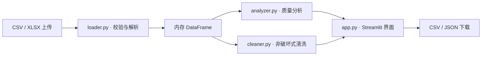

<div align="center">

# ⚙️ Engineering Notes

**CSV Doctor · 架构设计与工程实践**


</div>

> 本文介绍 v1.0 **已实现**的设计选择，不包含未验证的性能数据或生产级可用性承诺。

## 架构概览



核心计算独立于 UI，便于单元测试；文件在服务端内存中处理，不主动保存上传的原始数据。

## 关键问题与技术取舍

| 问题 | 已采用的方案 | 边界与取舍 |
| --- | --- | --- |
| **中文文件解析** | UTF-8 / UTF-8-SIG 优先，GB18030 回退；保留纯空白记录 | 不支持任意编码自动识别 |
| **异常检测可靠性** | 1.5×IQR；小样本、零 IQR、非有限阈值跳过并说明 | 离群不等于业务错误 |
| **清洗状态一致性** | 先去空白再去重；副本清洗；参数或工作表变化时旧预览失效 | 仅包含两种明确的清洗操作 |
| **导出安全** | UTF-8-SIG；可触发公式的文本加保护前缀；JSON 仅汇总统计 | 高风险文本的字面值可能变化 |
| **免费托管资源约束** | 10 MiB 上传限制、行列/单元格上限、XLSX 解压体积限制 | 不是大规模数据处理平台 |

## 可复现验收

仓库附有 `pytest` 测试与 GitHub Actions 工作流，覆盖读取、边界条件、清洗不可变性、报告序列化及 Streamlit 页面逻辑。

```bash
python -m pytest -q
```

历史本地开发报告记录 **63 项测试通过**；这不代表 GitHub Actions 已通过，发布后请以实际工作流状态为准。云端部署、多用户并发和生产级安全审计尚未完成验证。

## 延伸阅读

- [项目主页与实际截图](../README.md)
- [参与贡献](../CONTRIBUTING.md)
- [版本记录](../CHANGELOG.md)
